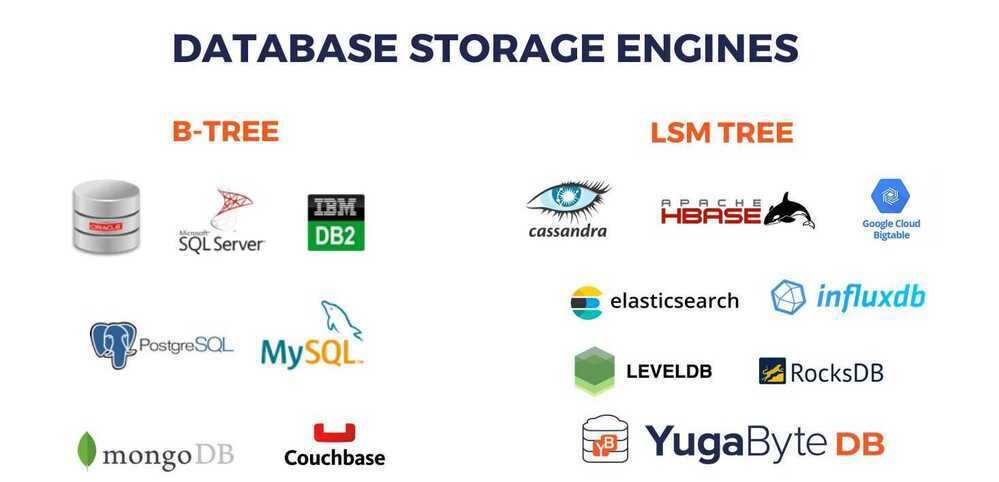

## Zstd (by facebook)

Zstandard, or zstd as short version, is a fast lossless compression algorithm, targeting real-time compression scenarios at zlib-level and better compression ratios. It's backed by a very fast entropy stage, provided by [Huff0 and FSE library](https://github.com/Cyan4973/FiniteStateEntropy) ⭐ 1.5k.

https://github.com/facebook/zstd

https://facebook.github.io/zstd

```bash
tar --use-compress-program=unzstd -xvf archive.tar.zst
tar --zstd -xvf archive.tar.zst
```

[Smaller and faster data compression with Zstandard - Engineering at Meta](https://engineering.fb.com/2016/08/31/core-infra/smaller-and-faster-data-compression-with-zstandard/)

## WebP (for images)

See > Image Formats

## cwebp (for image compression)

`for file in *.jpg; do cwebp -q 50 "$file" -o "${file%.jpg}.webp"; done`

## Brotli

Brotli is a generic-purpose lossless compression algorithm that compresses data using a combination of a modern variant of the LZ77 algorithm, Huffman coding and 2nd order context modeling, with a compression ratio comparable to the best currently available general-purpose compression methods. It is similar in speed with deflate but offers more dense compression.

https://github.com/google/brotli

## Snappy Compression

Snappy is a compression/decompression library. It does not aim for maximum compression, or compatibility with any other compression library; instead, it aims for very high speeds and reasonable compression. For instance, compared to the fastest mode of zlib, Snappy is an order of magnitude faster for most inputs, but the resulting compressed files are anywhere from 20% to 100% bigger.

Snappy has the following properties:

- Fast: Compression speeds at 250 MB/sec and beyond, with no assembler code. See "Performance" below.
- Stable: Over the last few years, Snappy has compressed and decompressed petabytes of data in Google's production environment. The Snappy bitstream format is stable and will not change between versions.
- Robust: The Snappy decompressor is designed not to crash in the face of corrupted or malicious input.
- Free and open source software: Snappy is licensed under a BSD-type license. For more information, see the included COPYING file.

### Performance

Snappy is intended to be fast. On a single core of a Core i7 processor in 64-bit mode, it compresses at about 250 MB/sec or more and decompresses at about 500 MB/sec or more. (These numbers are for the slowest inputs in our benchmark suite; others are much faster.) In our tests, Snappy usually is faster than algorithms in the same class (e.g. LZO, LZF, QuickLZ, etc.) while achieving comparable compression ratios.

Typical compression ratios (based on the benchmark suite) are about 1.5-1.7x for plain text, about 2-4x for HTML, and of course 1.0x for JPEGs, PNGs and other already-compressed data. Similar numbers for zlib in its fastest mode are 2.6-2.8x, 3-7x and 1.0x, respectively. More sophisticated algorithms are capable of achieving yet higher compression rates, although usually at the expense of speed. Of course, compression ratio will vary significantly with the input.

Although Snappy should be fairly portable, it is primarily optimized for 64-bit x86-compatible processors, and may run slower in other environments. In particular:

- Snappy uses 64-bit operations in several places to process more data at once than would otherwise be possible.
- Snappy assumes unaligned 32 and 64-bit loads and stores are cheap. On some platforms, these must be emulated with single-byte loads and stores, which is much slower.
- Snappy assumes little-endian throughout, and needs to byte-swap data in several places if running on a big-endian platform.

https://github.com/andrix/python-snappy

```python
python -m snappy -c uncompressed_file compressed_file.snappy

r = snappy.compress("hola mundo cruel!")
snappy.uncompress(r)
```

### Working

#### Phase 1: Blocks

The reference implementation fragments the input into blocks of up to 64 KB and compresses each independently, so back-references never cross a block boundary. This keeps the hash table small and cache-friendly and lets blocks be processed separately.

#### Phase 2: Match finding (LZ77-style)

Snappy scans the block and hashes every 4-byte sequence into a small hash table that remembers the last position where that sequence was seen. If the table points to an earlier position with the same bytes, it extends the match forwards and emits a copy. If not, the byte is kept as a literal. It takes the first match found and does no deeper search, and when it finds no matches for a while it skips ahead faster, which is why it is fast but gives a modest ratio. There is no pre-built dictionary and no sampling pass.

#### Phase 3: Output format

There is no Huffman or other entropy coding stage. The compressed stream is a varint holding the uncompressed length, followed by a sequence of elements. The low 2 bits of each element's tag byte give its type:

| Tag bits | Element | Notes |
|---|---|---|
| `00` | Literal | Raw bytes copied as-is, length stored in the tag or in following bytes |
| `01` | Copy, 1-byte offset | Length 4-11, offset up to 2047 |
| `10` | Copy, 2-byte offset | Length 1-64, offset up to 65535 |
| `11` | Copy, 4-byte offset | Length 1-64, offset up to 2^32 - 1 |

A copy means "repeat `length` bytes starting `offset` bytes back in the already-decompressed output".

#### Phase 4: Decompression

The decompressor reads the length preamble, then walks the elements: literals are copied straight to the output and copies are replayed from earlier output. It needs no tables or entropy decoding, which is why decompression is very fast. The raw format has no checksum; the separate framing format adds CRC-32C checksums per chunk.

## Codec Comparison: gzip vs zstd vs lz4 vs snappy

- **gzip (DEFLATE = LZ77 + Huffman):** good ratio, but the slowest of the four and the most CPU per byte. Memory is modest (about a 32 KB window).
- **zstd (LZ77 + FSE/Huff0 entropy coding):** best ratio of the four, and at its default level it is both smaller and faster than gzip. It has tunable levels (negative `--fast` levels up to 22). Higher levels cost much more compression CPU and a larger window/memory, but decompression speed stays roughly constant across levels.
- **lz4:** very fast compression and the fastest decompression, with a lower ratio than zstd or gzip. Smallest CPU and memory footprint.
- **snappy:** same class as lz4 (fast, modest ratio, low CPU). In practice lz4 is usually equal or better, so snappy is mostly kept for compatibility.

Reference numbers (lzbench, Silesia corpus, single core, from the zstd README):

| Compressor | Ratio | Compress | Decompress |
|---|---|---|---|
| zstd 1.5.7 -1 | 2.896 | 510 MB/s | 1550 MB/s |
| zlib 1.3.1 -1 (gzip's engine) | 2.743 | 105 MB/s | 390 MB/s |
| lz4 1.10.0 | 2.101 | 675 MB/s | 3850 MB/s |
| snappy 1.2.1 | 2.089 | 520 MB/s | 1500 MB/s |

**Rule "gzip/zstd = better ratio but more CPU and memory; snappy/lz4 = faster but lower ratio":** mostly true, with two corrections:

- zstd is not more CPU-hungry than gzip. At comparable or better ratio it compresses and decompresses faster. Only its high levels (10+) cost more CPU and memory than the fast codecs.
- lz4 and snappy are byte-oriented LZ77-style codecs with no entropy-coding (Huffman/FSE) stage and only a quick match search. That is why they are fast and give a lower ratio. gzip and zstd add entropy coding and a deeper match search.

Ratios on real data differ: JSON, logs and repeated-key formats compress well, while already-compressed payloads (images, encrypted data) gain nothing. Always benchmark on your own data. For how these codecs are used in Kafka (per-batch compression, broker recompression, `compression.type`), see [Optimize Confluent Cloud Clients for Throughput](technologies/confluent/cloud/confluent-cloud-client-throughput-optimization.md).

## Roaring Bitmaps

Roaring bitmaps are compressed bitmaps. They can be hundreds of times faster.

Bitsets, also called bitmaps, are commonly used as fast data structures. Unfortunately, they can use too much memory. To compensate, we often use compressed bitmaps.

Roaring bitmaps are compressed bitmaps which tend to outperform conventional compressed bitmaps such as WAH, EWAH or Concise. In some instances, roaring bitmaps can be hundreds of times faster and they often offer significantly better compression. They can even be faster than uncompressed bitmaps.

https://roaringbitmap.org

## Message Pack

MessagePack is an efficient binary serialization format. It lets you exchange data among multiple languages like JSON. But it's faster and smaller. Small integers are encoded into a single byte, and typical short strings require only one extra byte in addition to the strings themselves.

https://msgpack.org/index.html

## Digital Video

https://github.com/leandromoreira/digital_video_introduction
