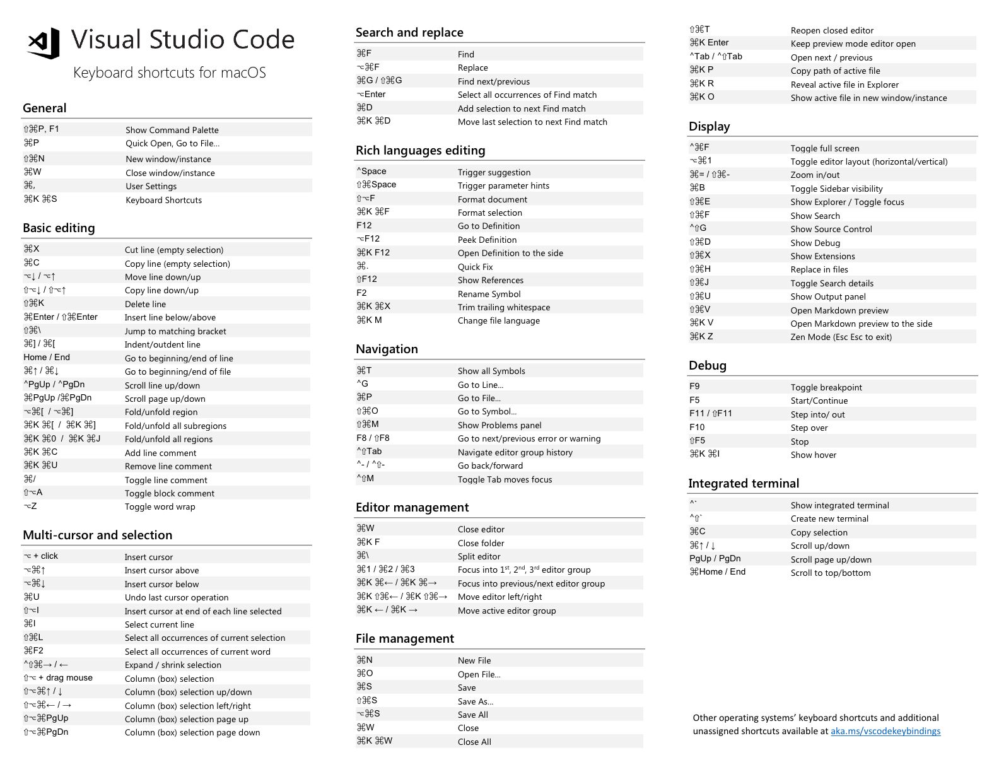

Remove empty lines - `Regex - ^(s)*$`

## History and Design

From [The Story of VS Code (Official Documentary)](https://youtu.be/kHL3XzjpT5w). The source is a speech-to-text transcript, so some names are uncertain.

- **Strategy:** Microsoft's developer tools historically served Windows only (C#, C++); VS Code was "meet developers where they are", meaning any OS, any language and any developer
- **Origin (~2010-11):** web apps were becoming full applications, so Microsoft put Steve Lucco on a JS engine, Anders Hejlsberg on TypeScript, and recruited Erich Gamma (Eclipse) to open a Zurich lab building a browser-born IDE
- **Monaco** was the browser code editor built first, and it is still VS Code's editor (also used in OneDrive and elsewhere). TypeScript and the editor co-evolved, with the editor team as TypeScript's earliest heavy customer
- **Desktop pivot:** a web-only editor was too narrow, so the team moved to Node WebKit and then Electron; it was announced at Build in April 2015 for Windows, Mac and Linux and open-sourced in November 2015 as a single snapshot commit (branding kept in a private build layer)
- **Performance rules:** never run long scripts on the UI thread, render only the visible lines (about 50) so cost is proportional to the edit even in million-line files, and hand-write DOM rendering instead of using jQuery
- **Extensions** run in a separate extension-host process, so a buggy extension never freezes the editor (the contrast with Atom's "everything hackable"). The tradeoff is a limited API surface, but extensions written a decade ago still run
- **Language Server Protocol (JSON-RPC):** language intelligence is written in the language's own stack and one server serves many editors (originated from the TypeScript server; 100+ languages now)
- **Remote development:** because the UI and extension host were already split, extensions can run remotely, which led to WSL, Dev Containers, Remote-SSH, Codespaces and vscode.dev (press the period key on GitHub). Atom declined after Microsoft acquired GitHub
- **Accessibility:** moved to the first item in iteration plans, with weekly meetings with screen-reader users and automated Playwright accessibility checks that can fail PRs
- **AI era:** Copilot grew from early-2020 GPT-3 access; AI features are built into VS Code rather than an extension, on an autonomy slider from ask to edits to agent mode, with release cadence moving from monthly to weekly. Forks such as Cursor and Windsurf build on VS Code because its UI APIs cannot cover every future UI

## Debugging Python

- https://github.com/microsoft/ptvsd
- https://www.youtube.com/watch?v=b78Tg-YmJZI

## CodeServer / Online Machine Environments

- VS Code in the browser
- https://github.com/cdr/code-server
- https://coder.com
- https://vscode.dev
- https://github.com/conwnet/github1s
- Gitpod - https://www.freecodecamp.org/news/exampro-cloud-developer-environment-certification-gitpod-course
- [Project IDX](https://idx.dev/) - Google
	- [Project IDX  \|  Google for Developers](https://developers.google.com/idx)
	- Project IDX is an AI-assisted workspace for full-stack, multiplatform app development in the cloud. With support for a broad range of frameworks, languages, and services, alongside integrations with your favorite Google products, IDX streamlines your development workflow so you can build and ship apps across platforms with speed, ease, and quality.
- codeanywhere

## Extensions

- Github Copilot
- Docker
- Kubernetes
- Git graph
- Python
- Terraform
- Local History
- ~~Clipboard History~~
- Remote - Containers
- SonarLint
- Data Preview (>Data: Preview Data)
- Git Lens
- Version Lens
- Prettier
- Format Toggle
- Settings Sync
- Cobalt2
- [Multiple clipboards for VSCode](https://marketplace.visualstudio.com/items?itemName=slevesque.vscode-multiclip)
- **Live Share**
- **Settingssync**
- CSV
    - Excel Viewer
    - RainbowCSV
- Reverse Search
- Thunder client - postman for vscode
- draw.io extension (test.dio file)
- https://marketplace.visualstudio.com/items?itemName=softwaredotcom.swdc-vscode
- https://marketplace.visualstudio.com/items?itemName=alefragnani.project-manager

## Shortcuts

- Shift+Option+F - format document
- CMD + option + z - zen mode
	- Cmd + K then release and press Z
- CMD + Shift + D - Duplicate line
- CMD + B = show hide project view
- Opt + Shift + O = remove unused migrations
- Opt + shift + down/up arrow = copy line down
- CMD + T = Show all Symbols
- CMD + Shit + O = Go to symbol (functions)
- CTRL + R = open recent dialogue
- CTRL + G = Go to line
- CMD + SHIFT + F = search whole project
- CMD + SHIFT + H = Find and replace whole project
- `cmd + opt + <-` = move left in open editors
- `cmd + opt + ->` = move right in open editors
- `cmd + K + cmd + S` = show all shortcuts
- `cmd + shift + T` = reopen last closed tab
- `Ctrl -` (go back)
- `Ctrl Shift -` (go forward)
- `Shift + Option F` (Format document)
- `Option + Command + Up/Down` - Multiline cursor
- Select All > `Option + shift + i` - Every line multiline cursor
- Search > `Command + Shift + L` - Cursor in every searched line
- `Opt + up/down arrow` - Move line up/down
- `cmd + opt + r` - Reveal in finder
- `cmd + option + c` - Copy current file path from system root (same as obsidian)

## Navigation

- Forward / Back - Ctrl + - / Ctrl + Shift + -
- Command Running - Command + p ( + >)
- git log - Command + Shit + p (directly run commands)
- Shell Command : Install code in PATH
- $ code .

- **Fold** folds the innermost uncollapsed region at the cursor:
    - ⌥+⌘+[on macOS
- **Unfold** unfolds the collapsed region at the cursor:
    - ⌥+⌘+]on macOS
- **Fold All** folds all regions in the editor:
    - ⌘+ (K=>0) (zero) on macOS
- **Unfold All** unfolds all regions in the editor:
    - ⌘+ (K=>J) on macOS



https://dev.to/selrond/tips-to-use-vscode-more-efficiently-3h6p

https://www.youtube.com/watch?v=WPqXP_kLzpo

https://www.youtube.com/watch?v=ifTF3ags0XI

## Settings.json (`command + <`)

- User Settings- Settings that apply globally to any instance of VS Code you open.
- Workspace Settings- Settings stored inside your workspace and only apply when the workspace is opened.

```json
{
    "python.jediEnabled": false,
    "editor.suggestSelection": "first",
    "vsintellicode.modify.editor.suggestSelection": "automaticallyOverrodeDefaultValue",
    "window.openFoldersInNewWindow": "on",
    "window.openFilesInNewWindow": "on",
    "terminal.integrated.shell.osx": "/bin/zsh",
    "PATH": "/bin/zsh",
    "files.autoSave": "onFocusChange",
    "workbench.editor.enablePreview": false,
    "editor.wordWrap": "on",
    "explorer.confirmDelete": false,
    "sqltools.connections": [
        {
            "database": "test",
            "dialect": "MySQL",
            "name": "localhost",
            "password": "test",
            "port": 3306,
            "server": "localhost",
            "username": "test"
        }
    ],
    "git.enableSmartCommit": true,
    "window.zoomLevel": 0,
    "[java]": {
        "editor.defaultFormatter": "redhat.java"
    },
    "java.configuration.checkProjectSettingsExclusions": false,
    "git.autofetch": true,
    "diffEditor.ignoreTrimWhitespace": false,
    "explorer.confirmDragAndDrop": false,
    "remote.extensionKind": {
        "ms-azuretools.vscode-docker": "workspace"
    },
    "git.ignoreMissingGitWarning": true,
    "python.dataScience.sendSelectionToInteractiveWindow": true,
    "python.dataScience.askForKernelRestart": false,
    "workbench.startupEditor": "welcomePage",
    "workbench.iconTheme": "vscode-icons",
    "editor.renderWhitespace": "all",
    "files.exclude": {
        "**/__pycache__": true
    }
  "terminal.integrated.scrollback": 10000,
}
```
